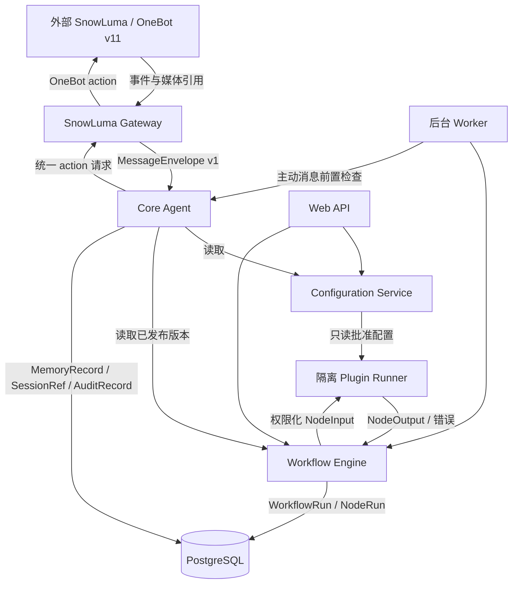

# VireyaBot 首期架构契约 v1

本文件固定插件、工作流、QQ 消息和数据隔离的首期边界。它是实现契约，不是工作流引擎、插件 Runner、搜索服务或主动发送实现。

## 1. 架构决策

| 边界 | 负责 | 不负责 | 事实来源 |
| --- | --- | --- | --- |
| Core Agent | 将统一消息、会话、人格、工具和记忆契约编排为一次运行；建立 trace 与审计引用 | 直接访问 WebSocket、数据库连接、插件代码、明文密钥 | PostgreSQL 资源记录；运行上下文 |
| SnowLuma Gateway | OneBot v11 transport、Bearer 鉴权、echo 关联、重连、媒体下载安全检查；只向 Core 暴露结构化 `MessageEnvelope`/响应 | QQ 登录、QQ session 持久化、业务权限、工作流执行 | 外部 SnowLuma；配置服务读取的连接配置 |
| Configuration Service | YAML 首次引导、PostgreSQL 配置、密钥加密/遮盖、配置变更审计 | 向插件或 Agent 广播全部密钥；将 YAML 覆盖管理员保存值 | PostgreSQL `settings`/`config_changes` |
| Plugin Registry | 校验 `PluginManifest`、权限和组件 schema 引用，保存安装版本 | 执行插件代码、注入前端 JS、提供数据库连接 | PostgreSQL 插件安装/版本记录 |
| Plugin Runner | 在隔离进程中执行已批准组件，限制时间/资源/能力，返回 `NodeOutput` 或错误 | 读取未授予资源、拿到全部密钥、直接发 QQ 消息 | Runner 进程结果；NodeRun |
| Workflow Engine | 读取已发布不可变 `WorkflowVersion`，按节点边执行并记录 `WorkflowRun`/`NodeRun` | 修改发布版本、绕过组件权限、直接调用外部 transport | PostgreSQL 草稿/版本/运行记录 |
| Web API | 管理认证、草稿编辑、发布、运行查询和配置管理；调用领域接口 | 在 API 进程执行插件代码；绕过同一权限策略 | PostgreSQL；审计记录 |
| Background Worker | 处理定时触发、有限重试、主动消息 kill switch/quiet hours/cooldown/frequency 检查 | 伪造用户授权、绕过群/用户隔离、持有长期明文密钥 | PostgreSQL 触发器与运行记录 |

首期明确不引入：市场、多租户、任意前端插件、分布式执行、Redis/Celery/Kafka、QQ 登录或 session 持久化。SnowLuma 仍是外部部署实例。

## 2. 数据流



所有跨边界对象带 `schema_version: "v1"`。Gateway 不把原始 OneBot payload 传入 Core；`raw` 仅停留在 Gateway 内部事件对象。媒体 `source_url` 是不可信输入，下载必须经过已有 Gateway 的类型、大小、超时、重定向和地址限制。

## 3. 统一对象与所有权

契约实现位于 `app/contracts.py`，生成的 JSON Schema 位于 `schemas/contracts-v1.json`。所有模型拒绝未知字段（`extra=forbid`）。

- `MessageEnvelope`：Gateway 创建，Core 消费；`ConversationRef` 明确 private 或 group，不允许同时带 `user_id` 和 `group_id`。
- `MediaRef`：Gateway/媒体存储拥有内容元数据；业务只引用 `id`、类型、大小和 sha256，不直接信任远程 URL。
- `SessionRef`：Core 拥有会话生命周期，并固定 `persona_version_id`；会话不可隐式切换人格版本。
- `PersonaRef`：人格资源及版本由配置/管理域拥有，运行只引用不可变版本。
- `ToolCall`/`ToolResult`：Core 生成调用，组件/Provider 返回结果；失败必须有稳定 `error_code`，不得以异常文本作为协议。
- `MemoryRecord`：Core/记忆存储拥有；`DataScope` 是强制隔离键。private 只能由同一 user 读取，group 只能由同一 group 读取，global 仅 system context。
- `PluginManifest`：Registry 拥有安装和版本；`permissions` 是能力上限，不是自动授权。每次节点运行仍需检查 workflow owner、actor scope 和组件权限。
- `WorkflowDraft`：owner 可变；`WorkflowVersion` 发布后不可变。`WorkflowRun` 启动时必须保存 `workflow_version_id`，运行期间禁止追随草稿变化。
- `NodeRun`：Engine 拥有执行状态；输入输出可审计，`NodeOutput.secret=true` 时只能进入获准的后续边界，不进入普通日志。
- `SecretRef`：Configuration Service 拥有；插件只能按 manifest 声明的能力获得命名引用，不能接收明文配置全集。
- `AuditRecord`：各边界写入 allowed/denied/failed 结果；拒绝也必须留记录，且日志中不得出现 token、密码、完整媒体内容或私有 prompt。

## 4. 权限与错误语义

权限顺序固定：认证主体 → 资源 owner/scope → workflow version → component manifest permission → capability-specific policy（例如搜索 URL 来源、主动消息 quiet hours/cooldown）→ 执行。任一层拒绝即停止，不尝试降级到更宽 scope。

`ContractAccessError.code` 和跨服务错误码采用稳定机器可读值：

| 错误码 | HTTP/运行语义 | 是否可重试 |
| --- | --- | --- |
| `auth.unauthenticated` | 未建立管理/运行主体，Web API 返回 401 | 否 |
| `scope.private_forbidden` | 访问其他 user 的 private 资源，返回 403；不泄露资源是否存在 | 否 |
| `scope.group_forbidden` | 访问其他 group 的资源，返回 403 | 否 |
| `scope.global_forbidden` | 非 system context 访问 global 资源，返回 403 | 否 |
| `contract.invalid` | JSON/Pydantic 约束失败，返回 422；字段路径可返回，secret 值不可返回 | 否 |
| `permission.denied` | manifest 或运行时 capability 不足，403/failed NodeRun | 否 |
| `workflow.version_missing` | 引用不存在/未发布版本，409 | 否 |
| `provider.unavailable` | 外部 Provider/Gateway 暂不可用，NodeRun failed | 由调用方退避；不自动改变 scope |
| `provider.timeout` | 外部调用超时，NodeRun failed | 有界重试，需保留同一 `run_id`/幂等键 |
| `rate_limited` | 频率、cooldown 或主动消息限制命中，记录 skipped/denied | 等待策略由 Worker 决定 |
| `internal.error` | 未分类故障，记录 trace_id，不把堆栈返回用户 | 谨慎，默认否 |

HTTP 映射不是领域契约的一部分；Worker/Runner 使用同一错误码而非 HTTP 状态。所有失败返回保留 `trace_id`、资源 id（若不泄露存在性）和 `retryable`，不返回 secret 或跨 scope 数据。

## 5. 版本与兼容策略

- `schema_version` 主版本只接受 `v1`。未知主版本 fail closed；不得把未知字段静默转发给插件。
- v1 的新增字段必须是有默认值的可选字段；删除、改类型、改变枚举含义、放宽 owner 规则必须升为 v2。
- Plugin `api_version` 必须与 Runner 支持版本精确匹配；Manifest 版本使用 `0.x.y`，组件 schema 引用必须存在并锁定摘要/版本。
- Workflow 草稿可迁移；已发布 `WorkflowVersion` 永不原地迁移，使用新版本重新发布。运行记录永远引用启动时的版本。
- Provider 能力（Responses、图像理解、搜索返回结构等）在 PRIV-20 实测前只标为 `provider.unavailable`/待验证；v1 不假定任何 provider 已支持。
- 数据库迁移只向前追加，配置 YAML 只作首次缺省值，不能覆盖 PostgreSQL 已保存值。

## 6. 三个流程走查

### 6.1 QQ 图文聊天

1. Gateway 接收 OneBot private/group 事件，验证 transport/auth，并将文本、at、reply、image 转为 `MessageEnvelope`；`MediaRef` 只记录受限下载结果。
2. Core 以 `conversation.kind` 和 sender 形成 `SessionRef`，读取 owner 对应的 `PersonaRef`；检查 `DataScope`。private 消息只接受同一 user，group 消息只接受同一 group。
3. Core 创建 `WorkflowRun`（若配置了聊天 workflow）并保存 `workflow_version_id`，节点输入只使用 envelope/session/media 引用；每个节点写 `NodeRun`。
4. 记忆写入使用 private 或 group scope；跨用户/群调用 `assert_scope_access` 返回 `scope.private_forbidden`/`scope.group_forbidden`，并写 denied `AuditRecord`，不回显目标资源存在性。
5. 回复前再次检查会话 scope 和发送权限，Core 只向 Gateway 发统一 action 请求；Gateway 负责 OneBot echo、错误映射和发送结果。失败返回 `provider.unavailable`、`provider.timeout` 或 OneBot error code，并保留 trace/run 记录。

资源所有者：Gateway 拥有 transport/media，Core 拥有 session/run，配置服务拥有 persona 引用，PostgreSQL 拥有记忆与审计。持久化：Message/媒体元数据、Session、WorkflowRun/NodeRun、MemoryRecord、AuditRecord。版本引用：schema v1、persona version、workflow version、embedding version（如有）。

### 6.2 插件提供 Web 搜索节点

1. Registry 校验并保存带 `api_version=v1` 的 Manifest；Web 搜索节点必须声明 `web.search`，输入/输出 schema 引用必须存在。
2. Workflow Draft 只保存 component ref 和非秘密配置；发布时 Engine 校验组件版本、owner 和权限，生成不可变 `WorkflowVersion`。
3. 运行时 Engine 先验证 workflow version，再按当前 actor/scope 检查 manifest permission；Runner 只收到 `NodeInput` 和获准的 search capability，不收到数据库连接或全部 secrets。
4. Runner 返回 `NodeOutput` 或 `ToolResult`。搜索回答只能引用该搜索 capability 返回的 URL；provider 未在 PRIV-20 实测前，失败为 `provider.unavailable`，不能假定搜索响应格式。
5. Engine 写 NodeRun 和 AuditRecord。Manifest 缺权限返回 `permission.denied`；输入不符 schema 返回 `contract.invalid`；超时为 `provider.timeout`，按有界策略处理，不改变用户/群 scope。

资源所有者：Registry 拥有 Manifest/安装版本，Workflow owner 拥有草稿，Engine 拥有发布版本/运行，Runner 拥有短生命周期执行结果。持久化：Manifest、schema 引用、草稿、发布版本、WorkflowRun/NodeRun、审计；不持久化未授权 secret。版本引用：plugin version、api v1、workflow version、contract schema ref。

### 6.3 定时主动私聊

1. Worker 从 PostgreSQL 读取启用的主动 workflow 和发布版本；检查全局 kill switch、功能开关、quiet hours、cooldown、frequency limit，以及目标 user 的明确授权/可达性。
2. Worker 为每个目标建立 private `ConversationRef` 和 `DataScope(private,user_id=target)`；读取记忆/人格前调用 scope 检查，不允许以 group 或其他 user 的上下文填充。
3. Worker 创建固定 `WorkflowRun`，保存 workflow version；Engine/Runner 执行节点并记录 NodeRun。任何权限、版本或 provider 错误都在 run 中记录，不能静默发送。
4. 发送前再次检查 kill switch、cooldown 和目标 scope，Core 通过 Gateway 发送；本任务不执行真实主动发送。成功/失败/跳过均写审计和频率记录，失败使用 `provider.timeout`/`provider.unavailable` 等稳定码。
5. 若命中 quiet hours/cooldown/frequency，返回 `rate_limited` 并记录 skipped，不伪造成功；跨用户尝试返回 `scope.private_forbidden`。

资源所有者：Worker 拥有调度状态，目标 user 拥有 private 授权与记忆，Workflow owner 拥有发布版本，Gateway 拥有发送 transport。持久化：trigger、授权/开关快照、WorkflowRun/NodeRun、发送结果、cooldown/frequency、AuditRecord。版本引用：workflow version、persona version、schema v1。真实 Provider 能力和主动发送由后续 PRIV-20 实测，当前仅做契约样例校验。

## 7. 验证入口

代表性契约样例和跨 scope 拒绝测试在 `tests/test_contracts.py`。生成/更新 JSON Schema：

```sh
uv run python -c 'import json; from pathlib import Path; from app.contracts import ContractCatalog; schema=ContractCatalog.model_json_schema(); schema={"$schema":"https://json-schema.org/draft/2020-12/schema","$id":"https://vireyabot.local/schemas/contracts-v1.json",**schema}; Path("schemas/contracts-v1.json").write_text(json.dumps(schema, ensure_ascii=False, indent=2) + "\\n")'
```

该命令只生成契约文件，不启动 Gateway、Runner、Workflow、搜索、模型或 QQ 会话。
