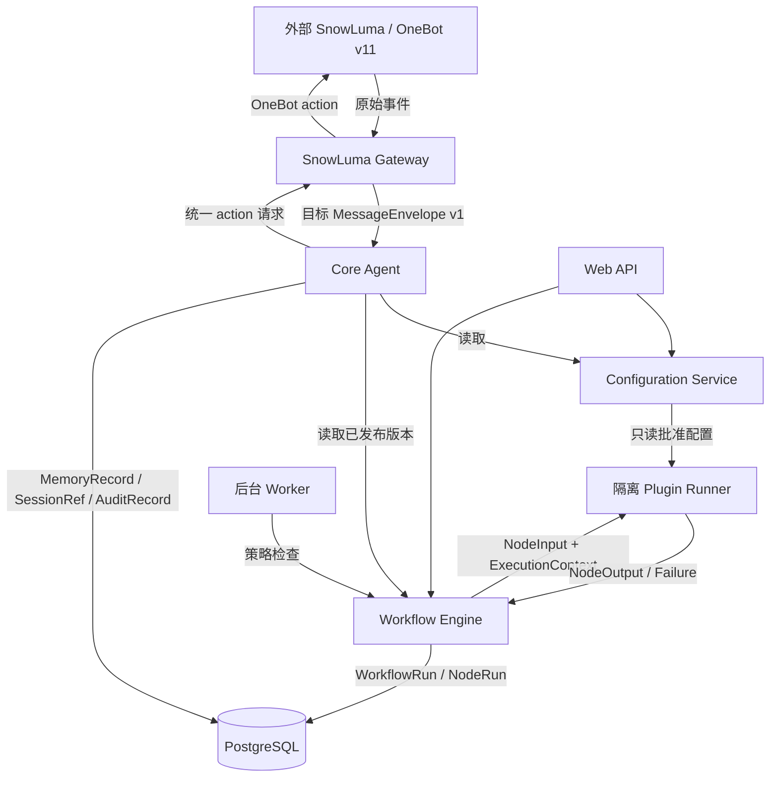

# VireyaBot 首期架构契约 v1

本文件固定插件、工作流、QQ 消息、主动私聊和数据隔离的首期边界。它是实现契约，不是工作流引擎、插件 Runner、搜索服务或主动发送实现。

## 1. 架构决策

| 边界 | 负责 | 不负责 | 事实来源 |
| --- | --- | --- | --- |
| Core Agent | 编排统一消息、会话、人格、工具和记忆；建立 trace 与审计引用 | 直接访问 WebSocket、数据库连接、插件代码、明文密钥 | PostgreSQL 资源记录；运行上下文 |
| SnowLuma Gateway | OneBot v11 transport、Bearer 鉴权、echo 关联、重连、媒体下载安全检查 | QQ 登录、QQ session 持久化、业务权限、工作流执行 | 外部 SnowLuma；配置服务连接配置 |
| Configuration Service | YAML 首次引导、PostgreSQL 配置、密钥加密/遮盖、配置审计 | 向插件或 Agent 广播全部密钥；以 YAML 覆盖管理员保存值 | PostgreSQL `settings`/`config_changes` |
| Plugin Registry | 校验 `PluginManifest`、权限、组件版本和 schema 引用，保存安装版本 | 执行插件代码、注入前端 JS、提供数据库连接 | PostgreSQL 插件安装/版本记录 |
| Plugin Runner | 在隔离进程执行已批准组件，限制资源和能力，返回 `NodeOutput` 或 `Failure` | 读取未授予资源、拿到全部密钥、直接发 QQ 消息 | Runner 结果；`NodeRun` |
| Workflow Engine | 读取已发布不可变 `WorkflowVersion`，按节点边执行并记录运行 | 修改发布版本、绕过组件权限、直接调用 transport | PostgreSQL 草稿/版本/运行记录 |
| Web API | 管理认证、草稿编辑、发布、运行查询和配置管理 | 在 API 进程执行插件代码；绕过领域权限 | PostgreSQL；审计记录 |
| Background Worker | 定时触发、有限重试、主动消息 kill switch/quiet hours/cooldown/frequency 检查 | 伪造用户授权、绕过用户/群隔离、持有长期明文密钥 | PostgreSQL 触发器与运行记录 |

首期明确不引入：市场、多租户、任意前端插件、分布式执行、Redis/Celery/Kafka、QQ 登录或 session 持久化。SnowLuma 仍是外部部署实例。

## 2. 数据流



所有跨边界对象带 `schema_version: "v1"`。当前 Gateway 的公开事件仍是 `OneBotEvent(post_type, raw)`；`raw` 只能停留在 Gateway。目标转换器尚未实现，后续实现必须只按本节映射构造 `MessageEnvelope`，不得把 raw 传入 Core。媒体 `source_url` 是不可信输入，下载必须经过类型、大小、超时、重定向和地址限制。

## 3. 统一对象、所有权与锁定引用

契约实现位于 `app/contracts.py`，生成的 JSON Schema 位于 `schemas/contracts-v1.json`。所有模型拒绝未知字段（`extra=forbid`）。Python 自定义校验（scope 组合、状态条件、边引用和策略顺序）不能由 JSON Schema 自动等价表达；两者必须分别验证。

- `MessageEnvelope`：Gateway 创建，Core 消费；`ConversationRef` 明确 private 或 group。
- `MediaRef`：只验证 MIME 语法、大小和摘要。`image/svg+xml` 是语法有效类型，但 `is_download_permitted_media_type` 的 Gateway 下载 allowlist 不包含 SVG；格式接受不等于允许下载。
- `SessionRef`：Core 拥有生命周期，并固定 `persona_version_id`。
- `ToolCall`/`ToolResult`：Core 生成调用，组件/Provider 返回；失败使用统一 `Failure(trace_id, error_code, retryable, message)`。
- `MemoryRecord`：Core/记忆存储拥有；`DataScope` 是强制隔离键。
- `PluginManifest`：Registry 拥有安装和版本；权限是能力上限，不是自动授权。
- `WorkflowDraft`：owner 可变；`WorkflowVersion` 发布后不可变。运行保存 `workflow_version_id`。
- `NodeInput`：除 name/value 外必须携带 Engine 传来的 `ExecutionContext`，其中包含可信 actor、当前 conversation、scope、锁定 `workflow_version_id`、锁定 `component_ref` 和已授予 capabilities。
- `NodeRun`：失败必须有 `trace_id` 和统一 `Failure`；非失败状态不得携带 Failure。
- `SecretRef`：Configuration Service 拥有；插件只能按 manifest 声明获得命名引用。
- `AuditRecord`：边界写入 allowed/denied/failed；拒绝也必须记录，日志不含 token、密码、完整媒体或私有 prompt。

### 3.1 引用格式与校验责任

- `component_ref` 格式固定为 `plugin-id@0.x.y/component-id`。Registry 在安装时校验 Manifest；发布时 Engine 校验引用存在、版本精确匹配且属于已批准安装；Runner 只执行 `ExecutionContext.component_ref` 指定版本。
- `input_schema_ref`/`output_schema_ref` 格式固定为 `urn:vireyabot:<name>:v1`。Registry 校验 schema 存在且摘要/版本锁定；Engine 发布时重新校验节点输入输出兼容；Runner 执行前按锁定 schema 校验输入。
- `api_version` 必须精确匹配 Runner 支持版本。未知主版本、未知字段和未锁定引用均 fail closed。

## 4. 权限与错误语义

权限顺序固定：可信认证主体 → 当前 conversation 与资源 scope → workflow version → component manifest permission → capability-specific policy → 执行。任一层拒绝即停止，不降级到更宽 scope。

`AccessContext` 是唯一 scope 检查输入：

- private：actor 必须是目标 user，且当前 conversation 必须是同一 user 的 private conversation；同用户群上下文也拒绝。
- group：actor 必须是 user，且当前 conversation 必须是目标 group；跨群拒绝。
- global：只接受显式 `Principal(kind="system", ...)` 且无 conversation；缺失 actor 不是 system。

跨边界失败使用稳定错误码：

| 错误码 | 语义 | retryable |
| --- | --- | --- |
| `auth.unauthenticated` | 未建立主体，Web API 401 | 否 |
| `scope.private_forbidden` | private 资源不属于当前 private conversation | 否 |
| `scope.group_forbidden` | group 资源不属于当前 group conversation | 否 |
| `scope.global_forbidden` | 非显式 system 访问 global | 否 |
| `contract.invalid` | JSON/Pydantic 约束失败 | 否 |
| `permission.denied` | manifest 或 capability 不足 | 否 |
| `workflow.version_missing` | 引用不存在/未发布版本 | 否 |
| `provider.unavailable` | 外部 Provider/Gateway 不可用 | 由调用方退避 |
| `provider.timeout` | 外部调用超时 | 有界重试 |
| `rate_limited` | quiet hours/cooldown/频限命中 | 等待策略由 Worker 决定 |
| `internal.error` | 未分类故障 | 默认否 |

`Failure`、`ToolResult`、`NodeRun` 失败均保留 `trace_id`、稳定 `error_code` 和 `retryable`，可选 message 不得泄露 secret 或跨 scope 数据。`NodeRun` 的 `queued/running/succeeded/skipped` 不得带失败对象。

## 5. 版本与兼容策略

- `schema_version` 只接受 `v1`；未知主版本 fail closed。
- v1 新增字段必须是有默认值的可选字段；删除、改类型、改变枚举含义、放宽 owner 规则升为 v2。
- 已发布 `WorkflowVersion` 永不原地迁移，使用新版本重新发布；运行永远引用启动版本。
- Provider 能力在后续实测前只标为待验证；v1 不假定 Responses、图像理解、搜索结构或主动发送已支持。
- 数据库迁移只向前追加，YAML 只作首次缺省值，不能覆盖 PostgreSQL 已保存值。

## 6. OneBot 事件、动作与错误映射

当前实现事实：`SnowLumaGateway` 接收并返回 `OneBotEvent`/`OneBotResponse`，不生成 `MessageEnvelope`。以下是目标转换契约和合成事件验收表，不表示转换器已实现。

| OneBot/raw | MessageEnvelope v1 | 规则 |
| --- | --- | --- |
| `message_id` 或生成的事件 id | `id` | 必须非空并作为幂等引用 |
| `time` | `occurred_at` | Unix 秒转 UTC datetime |
| `message_type=private`, `user_id` | private `conversation`、`sender` | private scope 绑定同一 user |
| `message_type=group`, `group_id`, `user_id` | group `conversation`、user sender | group scope 绑定 group |
| `message` text segment | `TextSegment` | 只接受合法字段 |
| `message` image segment | `ImageSegment(MediaRef)` | 先经过媒体下载安全检查 |
| `at` segment | `MentionSegment` | target 必须是合法 Principal |
| `reply` segment | `ReplySegment` | 只保存 message id |

Core → Gateway 的统一 action 目前仍由 `send_private_msg`/`send_group_msg` 映射到 OneBot action。Gateway 返回 `OneBotResponse(status, retcode, data, echo)`；`status != ok` 或非零 retcode 映射为带 trace 的 `provider.unavailable`/协议错误，不能伪造成功。目标转换器必须覆盖 private text/image、group text/image、未知 message_type 拒绝、缺失 sender/group id 拒绝四类合成事件；真实 QQ 不在本任务内。

## 7. 三个流程走查

### 7.1 QQ 图文聊天

1. Gateway 验证 transport/auth，目标转换器按 6 节映射文本、at、reply、image；`MediaRef` 只记录受限下载结果。
2. Core 以 conversation/sender 建立 SessionRef，读取固定 PersonaRef；用 `AccessContext` 检查 DataScope。
3. Core 创建 `WorkflowRun`，保存 `workflow_version_id`；每个节点以含 ExecutionContext 的 NodeInput 调用 Runner，并写 NodeRun。
4. 记忆写入 private 或 group scope；跨用户、同用户群上下文和跨群访问均返回 scope 错误并写 denied AuditRecord。
5. 回复前再次检查 scope 和发送权限；Core 只向 Gateway 发 action，失败保留 trace/run 记录。

所有者：Gateway transport/media，Core session/run，配置域 persona，PostgreSQL memory/audit。持久化：消息/媒体元数据、Session、WorkflowRun/NodeRun、MemoryRecord、AuditRecord。失败：`contract.invalid`、`scope.*`、`provider.*`。

### 7.2 插件提供 Web 搜索节点

1. Registry 校验 Manifest、`web.search`、组件版本和 schema 引用。
2. Draft 只保存 component ref 和非秘密配置；发布时 Engine 锁定 plugin/component/schema/workflow version。
3. Engine 将 actor、conversation、scope、workflow version、component ref、`web.search` capability 放入 NodeInput.context；Runner 不接收数据库连接或全部 secrets。
4. Runner 返回 NodeOutput 或统一 Failure。回答只能引用该 capability 返回的 URL；Provider 未验证时返回 `provider.unavailable`。
5. Engine 写 NodeRun/AuditRecord；权限不足 `permission.denied`，schema 不符 `contract.invalid`，超时 `provider.timeout`。

### 7.3 定时主动私聊

1. Worker 读取已启用 workflow 和发布版本，快照全局 kill switch、功能开关、quiet hours、cooldown、frequency limit 和目标 user 明确授权。
2. 目标建立 private ConversationRef/DataScope；调用 scope 检查，不能用 group 或其他 user 上下文填充。
3. Worker 创建固定 WorkflowRun，保存 workflow version；Engine/Runner 写 NodeRun。策略未通过时不得调用发送 action。
4. 发送前再次检查 kill switch、cooldown、频限和 scope；允许时才由 Core 请求 Gateway。成功、失败、跳过均写 AuditRecord 与频率记录。
5. 未授权返回 denied；quiet hours/cooldown/frequency 或 kill switch 返回 skipped/`rate_limited`；Provider 错误返回带 trace 的 Failure。

所有者：Worker 调度状态，目标 user private 授权/记忆，Workflow owner 发布版本，Gateway transport。持久化：trigger、授权/开关快照、WorkflowRun/NodeRun、发送结果、cooldown/frequency、AuditRecord。此处只做契约策略走查，不发送真实消息。

## 8. 验证入口

代表性契约样例、五类 scope 结果、媒体语法/下载区分、失败状态约束、三流程策略走查在 `tests/test_contracts.py`。当前 OneBot raw 边界和动作协议在 `tests/test_onebot.py`。

生成 Schema：

```sh
uv run python -c 'import json; from pathlib import Path; from app.contracts import ContractCatalog; schema=ContractCatalog.model_json_schema(); schema={"$schema":"https://json-schema.org/draft/2020-12/schema","$id":"https://vireyabot.local/schemas/contracts-v1.json",**schema}; Path("schemas/contracts-v1.json").write_text(json.dumps(schema, ensure_ascii=False, indent=2) + "\n")'
```

该命令只生成契约文件，不启动 Gateway、Runner、Workflow、搜索、模型或 QQ 会话。
